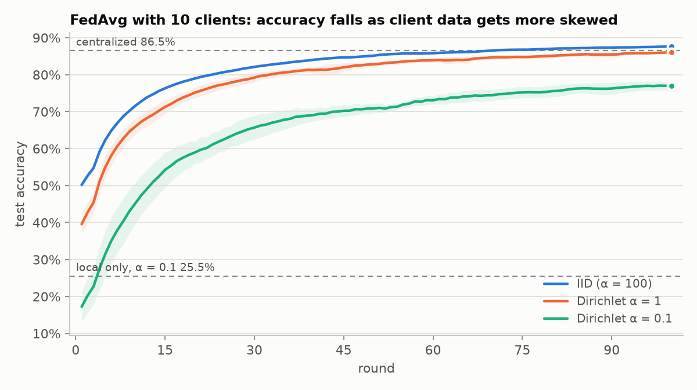
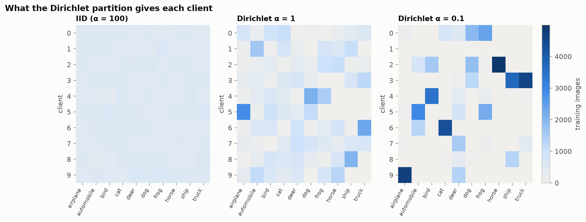
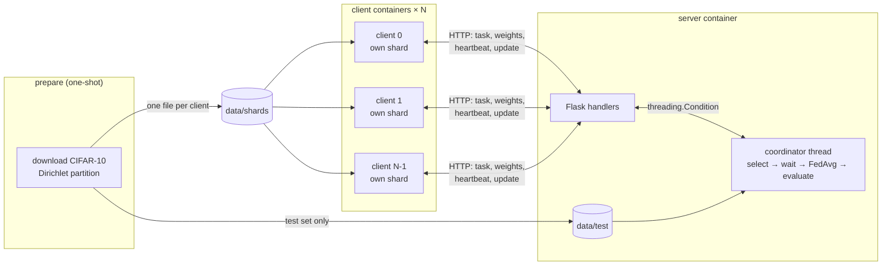
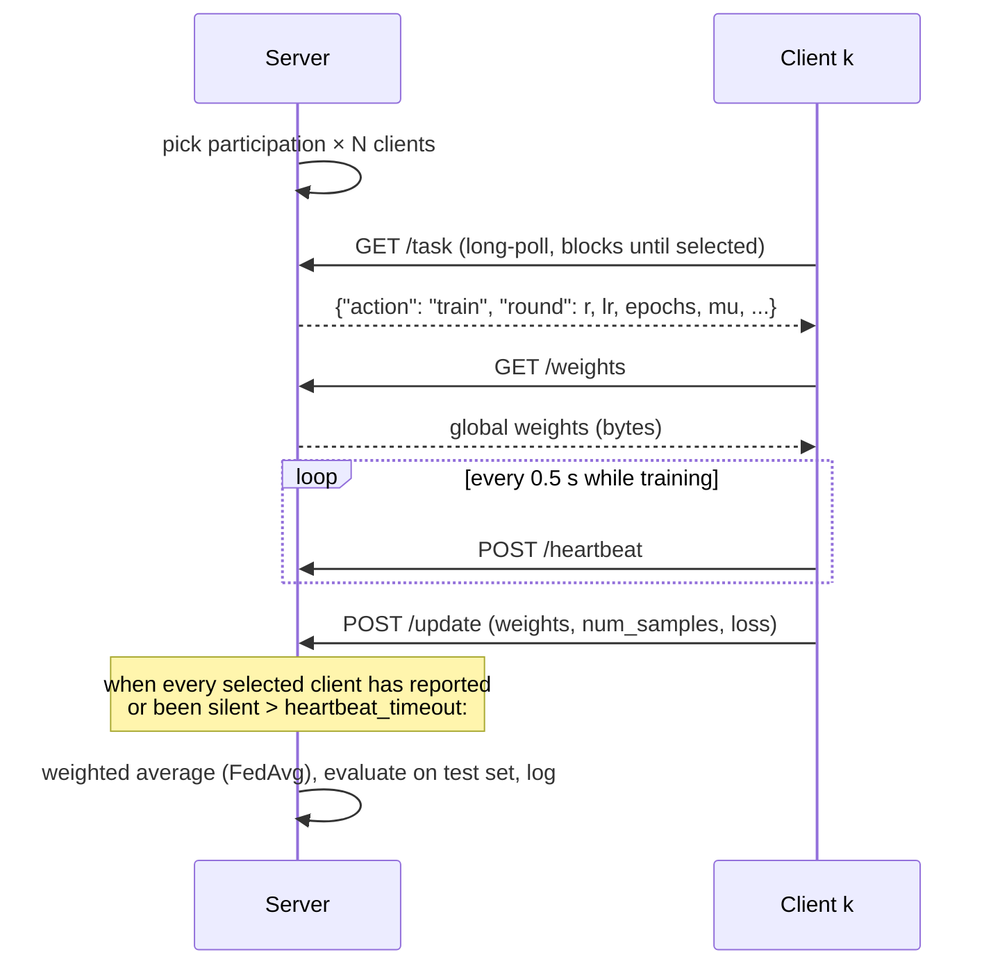

# Federated learning under non-IID data, from scratch

A federated learning system built from first principles (PyTorch, a hand-written Flask server, one Docker container per client) and used to answer one question:

> **How much does uneven (non-IID) client data hurt FedAvg, and how much of that does FedProx recover?**

No FL framework: the server, the client protocol, FedAvg, FedProx, the Dirichlet partition and the dropout handling are all in this repo, in about 1,200 lines of commented Python.

<!-- Record the Docker demo (dashboard + `docker compose kill client`) and save it as docs/demo.gif -->
<!--  -->

## Results

CIFAR-10, small CNN, 10 clients, 100 rounds, 2 local epochs per round, 3 seeds per configuration. Curves show the mean over seeds with a 5-round moving average (non-IID runs swing a lot from round to round); shaded bands are ±1 standard deviation over seeds. The raw per-round numbers are in `results/runs/*/seed*/metrics.jsonl`.

<!-- results:start -->
| Run | Data split | Clients | Final test accuracy (%) | Rounds to 60% | Seeds |
|---|---|---|---|---|---|
| Centralized | pooled (all data) | 1 | 86.5 ± 0.3 | 2 epochs | 3 |
| Local only | IID (α = 100) | 10 | 68.1 ± 0.1 | 15 epochs | 3 |
| Local only | Dirichlet α = 1 | 10 | 55.7 ± 2.1 | not reached | 3 |
| Local only | Dirichlet α = 0.1 | 10 | 25.5 ± 0.9 | not reached | 3 |
| FedAvg | IID (α = 100) | 10 | 87.6 ± 0.0 | 4 | 3 |
| FedAvg | Dirichlet α = 1 | 10 | 85.9 ± 0.3 | 7 | 3 |
| FedAvg | Dirichlet α = 0.1 | 10 | 77.0 ± 1.1 | 21 | 3 |

- Centralized upper bound: 86.5%
- FedAvg, 10 clients: 87.6% at α = 100 → 77.0% at α = 0.1 (-10.5 points)
- Local-only lower bound at α = 0.1: 25.5%
<!-- results:end -->

**So far:** federation matches centralized training on IID data. Under strong label skew (α = 0.1) FedAvg loses about 10 points, but still sits about 52 points above clients training alone.

**Not run yet:** the FedProx μ sweep (`04`), scaling (`05`) and dropout (`06`). `python -m scripts.run_all` runs them, skipping everything above, and adds their rows and plots. Until then the question of how much FedProx recovers is open.

**Note on one seed:** in FedAvg α = 0.1 seed 2, the server dropped 110 of about 1,000 client updates (timeouts while the machine was heavily loaded by another job). Its accuracy, 76.7%, lies between the other two seeds (78.6% and 75.9%).





## Architecture



Clients pull work; the server never opens a connection to a client, so `--scale client=N` needs no address list. The server container mounts only the test set and the client containers mount only the shards, so the server cannot read training data even by accident.

One round:



## Quick start

```bash
pip install torch --index-url https://download.pytorch.org/whl/cu128   # or /whl/cpu without a GPU
pip install -r requirements.txt

pytest -q                                                    # unit + end-to-end tests (~1 min, CPU)
python -m scripts.run_experiments configs/smoke.yaml         # every code path on synthetic data (~2 min, CPU)
```

**Docker demo, one command** (needs an NVIDIA GPU with Docker Desktop/WSL2 or the NVIDIA Container Toolkit):

```bash
docker compose up --build --scale client=10
```

Open <http://localhost:8000> to watch clients get selected, train, report or drop out, and the global accuracy climb. To see a real crash, find a client with `docker ps` and `docker kill <name>`: the server marks it dropped whenever it is selected and carries on. `docker compose up -d --scale client=10` starts a replacement, which takes over the dead client's id and shard after 60 s of silence. The server keeps the dashboard up after the last round; stop everything with Ctrl-C. No GPU: add `-f docker-compose.yml -f docker-compose.cpu.yml` after `docker compose`.

**All experiments, then the table and plots, in one resumable command** (an overnight job; Ctrl-C and re-run to continue):

```bash
python -m scripts.run_all --gpu-clients 10
```

It runs experiments 00–05, writes the best FedProx μ from `04_fedprox_mu.yaml` into `06_dropout.yaml`, runs the dropout experiment and pastes the table into this README. `python -m scripts.run_all --dry-run` shows what is left. The steps can also be run by hand with `python -m scripts.run_experiments <configs>` and `python -m scripts.report --readme`.

## Experiments

Every run is fully described by a YAML file in `configs/` plus the defaults in [`fl/config.py`](fl/config.py) (10 clients, 100 rounds, 2 local epochs, batch 64, SGD with lr 0.01 and momentum 0.9). Seeds fix the partition, the model initialisation, client selection, local shuffling and the simulated dropouts.

| Config | Question | Runs × seeds |
|---|---|---|
| `00_local_only.yaml` | Lower bound: each client alone, α ∈ {100, 1, 0.1} | 3 × 3 |
| `01_centralized.yaml` | Upper bound: all data in one place | 1 × 3 |
| `02_fedavg_iid.yaml` | FedAvg on a near-IID split (α = 100) | 1 × 3 |
| `03_fedavg_noniid.yaml` | FedAvg at α = 1 and α = 0.1 | 2 × 3 |
| `04_fedprox_mu.yaml` | FedProx at α = 0.1, μ ∈ {0.001, 0.01, 0.1, 1} | 4 × 3 |
| `05_scaling.yaml` | 5 / 10 / 20 clients × 50% / 100% participation, α = 0.1 | 5 × 3 (one shared with 03) |
| `06_dropout.yaml` | 20% of selected clients go silent each round | 2 × 3 |

That is 54 runs. Results land in `results/runs/<run>/seed<k>/` (`config.json`, `metrics.jsonl` with one line per round, `summary.json`, `logs/`). A run requested by two configs is trained once, and a finished run is never re-trained unless you delete its folder; the runner refuses to reuse a folder produced with different settings.

The **results table** reports, for each run: data split, number of clients, final test accuracy (mean over seeds of each seed's average over its last five evaluations, since non-IID curves are noisy round to round) and rounds to reach the target accuracy (60% by default, set by `target_acc`).

## How it works

### The server ([`server/app.py`](server/app.py))

A Flask app and one coordinator thread share state behind a single `threading.Condition`. The coordinator loop is: wait for all clients to register → for each round, sample `participation × N` clients, open the round, wait, aggregate, evaluate on the test set, log a JSONL line.

| Endpoint | Purpose |
|---|---|
| `POST /register` | Assigns the lowest free client id (= which shard to load) and returns the run spec |
| `POST /ready` | Client loaded its shard; reports its sample count |
| `GET /task` | Long-poll: returns `train` as soon as the client is selected, `wait` after 15 s, `stop` at the end |
| `GET /weights` | Current global weights as raw bytes |
| `POST /heartbeat` | "Still training" |
| `POST /update` | Trained weights + sample count; rejected if stale (409) or malformed (400) |
| `GET /status`, `GET /` | JSON snapshot and the live dashboard |

**Fault tolerance.** A selected client must pick up its task and then heartbeat at least every `heartbeat_timeout` seconds (2 s by default; clients beat every 0.5 s). A client that goes silent is marked dropped, the round closes without it, and any update it sends later is rejected as stale. Slow clients are never dropped as long as they keep beating. If every selected client drops, the global model is kept unchanged. A newly started client can take over the id (and shard) of a client that has been silent for 60 s, so a crashed container can be replaced mid-run. Weights are deserialised with `torch.load(weights_only=True)`, so a malicious peer cannot run code through a pickled payload, and their keys and shapes are checked before aggregation.

### The client ([`client/client.py`](client/client.py))

Register → load its own shard onto the GPU as uint8 → loop on `GET /task` → fetch weights → train with a background heartbeat thread → upload. Batches are normalised and augmented (random crop with 4-pixel padding, horizontal flip) on the GPU, so there are no DataLoader workers.

### FedAvg and FedProx ([`fl/aggregate.py`](fl/aggregate.py), [`fl/train.py`](fl/train.py))

FedAvg sets the new global model to the sample-weighted mean of the returned client models, $w \leftarrow \sum_k \frac{n_k}{n} w_k$. Updates are summed in client-id order in float64, so the result does not depend on arrival order.

FedProx keeps that aggregation and changes only the local objective, adding a pull towards the global weights the client started from:

$$\min_w \; \mathcal{L}_k(w) + \frac{\mu}{2}\lVert w - w_{\text{global}}\rVert^2$$

With μ = 0 this is exactly FedAvg (there is a test for it). Larger μ limits client drift on skewed data but also limits how much each client learns per round, which is why μ is swept.

### Non-IID data ([`fl/data.py`](fl/data.py))

For each class, proportions over clients are drawn from Dirichlet(α, …, α) and that class's images are dealt out accordingly (Hsu et al., 2019). α = 100 gives every client about 10% of each class; α = 0.1 leaves most clients with one to three classes. As in NIID-Bench, a client that already holds an even share gets no more, and the draw repeats until every client has at least 10 images. Small α skews quantities as well as labels: at α = 0.1 one client can end up with a few dozen images while another holds 9,000, and FedAvg's sample weighting makes the small one nearly irrelevant. `results/plots/partitions.png` shows what each client actually gets.

### Baselines

*Centralized* trains the same model with the same optimiser on all 50,000 images (upper bound). *Local only* trains one model per client on its shard alone and reports the mean of their test accuracies (lower bound). Both reuse `train_local`, so the only difference from the federated runs is where the data lives.

### The model ([`fl/model.py`](fl/model.py))

Five 3×3 conv layers and two linear layers, about 0.67 M parameters, **no BatchNorm**. BatchNorm's running statistics would be averaged across clients whose label mixes differ, which is a second, separate source of non-IID damage (the subject of FedBN). Leaving it out keeps the experiment about one thing.

## Hardware notes

- Each process that uses CUDA holds its own context, roughly 0.3–0.5 GB of GPU memory before any data. A 6 GB RTX 3060 fits the server plus about 10 GPU clients. For the 20-client runs pass `--gpu-clients 10`: the remaining clients train on the CPU and become the stragglers of each synchronous round, so those runs are slower but give the same accuracy.
- Under WSL2 the Linux VM gets half the host's RAM by default. Twenty CUDA processes can exceed that, which is another reason to cap `--gpu-clients`.
- The runner launches clients as local processes rather than containers, so a 54-run sweep does not pay container start-up every time. It is the same code and the same HTTP protocol that Docker runs.
- Time the first FedAvg run before launching everything; the full sweep is an overnight job on a laptop GPU.

## Design decisions and caveats

- **Uniform random dropout is close to partial participation.** If each selected client drops independently with probability 0.2, the server simply averages a random 80% of the selected clients, which is statistically what 80% participation does. Expect a small accuracy cost; the interesting part of this experiment is that the *system* survives it (heartbeats, timeouts, stale-update rejection). Dropout that correlates with data, such as clients holding rare classes dropping more often, would hurt far more and is a natural next experiment.
- **Simulated privacy boundary.** Shards are files on one disk. Each client opens only its own file and the server container cannot see any of them, but this is a simulation of data locality, not a security boundary. The server also sees every individual update; secure aggregation or differential privacy (Opacus) would be needed to hide them.
- **Synchronous rounds.** The slowest selected client sets the pace of every round. Asynchronous FL (FedBuff and others) avoids that at the cost of stale updates.
- **One learning rate for everything.** lr 0.01 with momentum 0.9 follows NIID-Bench; 0.02 diverged in my synthetic-data tests without BatchNorm. Tune it on the centralized baseline before the sweep if centralized accuracy disappoints.
- **Accuracy is measured on the global, balanced test set**, which is what FedAvg optimises for. A personalised-FL evaluation (each client's own label distribution) would tell a different story.

## What I learned

<!-- Fill this in from your own results. Questions worth answering:
- How many points did FedAvg lose going from alpha = 100 to alpha = 0.1, and how noisy did training get?
- Did FedProx help? For which mu, and was the gain larger than the seed-to-seed spread?
- Did more clients or lower participation hurt more at alpha = 0.1?
- What did 20% dropout cost, and how does that compare with 50% participation?
- What broke while building the server (deadlocks, stale updates, GPU memory) and how you found it. -->

## Repository layout

```
fl/              shared code: config, data + Dirichlet partition, model, training, aggregation
server/app.py    Flask server and coordinator thread; static/dashboard.html
client/client.py client process
scripts/         run_all (whole study), run_experiments (YAML sweeps), centralized, local_only, prepare_data, report
configs/         one YAML per experiment; smoke.yaml and demo.yaml
tests/           partition, aggregation, FedProx, protocol, and real multi-process runs
results/         runs/<run>/seed<k>/ (metrics, summaries), plots/, results.md
```

## References

- McMahan et al., *Communication-Efficient Learning of Deep Networks from Decentralized Data* (FedAvg), AISTATS 2017.
- Li et al., *Federated Optimization in Heterogeneous Networks* (FedProx), MLSys 2020.
- Hsu, Qi, Brown, *Measuring the Effects of Non-Identical Data Distribution for Federated Visual Classification*, 2019.
- Li, Diao, Chen, He, *Federated Learning on Non-IID Data Silos: An Experimental Study* (NIID-Bench), ICDE 2022.
